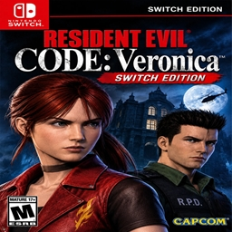

<div align="center">



# Resident Evil Code: Veronica X — NX Port

**A native Nintendo Switch port of *Resident Evil Code: Veronica X* (PS2)**


🇧🇷 [Português](README.md) · 🇺🇸 **English** · 🇪🇸 [Español](README.es.md)

[**Download**](../../releases/latest) · [Installation](#-installation) · [Controls](#-controls) · [Building](#%EF%B8%8F-building) · [Credits](#-credits)

</div>

> [!IMPORTANT]
> **This repository does not contain the game.** You need your own original copy of
> *Resident Evil Code: Veronica X* (PS2, NTSC-U, **SLUS-20184**), dumped by you to an `.iso` file.

---

## 📖 About

The game's original code, from the [recvx-decomp](https://github.com/AshfordFamily/recvx-decomp) decompilation,
is **compiled natively for the Switch's ARM64 CPU**. **It is not an emulator:** only the PS2 hardware at the
game's edges (GS, VU, DMA, sound, disc, memory card and pad) is reproduced, and the heavy parts are replaced by
native paths. The game reads your ISO straight from the SD card.

The port is based on [Project Veronica](https://github.com/camybiohazard/Project-Veronica), the native PC port.

## ✨ Features

| | |
|---|---|
| 🎮 **Native** | Game code compiled for ARM64, GPU rendering with OpenGL 3.3 |
| 🖥️ **Enhanced picture** | Widescreen, higher internal resolution, in-between frames for smooth motion (the game logic stays at its original 30 FPS) |
| 🎯 **Gyro aiming** | Works in handheld mode, on the Pro Controller and on Joy-Con, with adjustable speed and inversion |
| 🧍 **Third person** | Optional over-the-shoulder camera with free aim and auto-aim |
| ⚡ **Quick menu** | **L3 + R3** opens a console-style menu with the main options, without leaving the game |
| 🧪 **Cheats** | Infinite health and ammo, heal, give any item, noclip, unlock all |
| 💾 **Modern saves** | Every save is its own file on the SD card, as many as you like |
| 🧩 **Mods** | Replacement rooms and archive entries, and PCSX2 HD texture packs as they come |

## 📦 Requirements

- A Nintendo Switch with homebrew (Atmosphère + Homebrew Menu)
- Your ISO of *Resident Evil Code: Veronica X* — PS2, NTSC-U, **SLUS-20184**
- About 4 GB free on the SD card

> [!TIP]
> Open the Homebrew Menu by **holding R while starting a game** (title takeover), not from the Album. Applet
> mode has much less memory and the game may not start.

## 🚀 Installation

1. Download `recvx.nro` from the [Releases](../../releases/latest) page.
2. Copy it to the SD card at `sdmc:/switch/recvx/`.
3. Put **your** ISO in the same folder (any name ending in `.iso`).
4. Start **Code: Veronica X** from the Homebrew Menu.

```
sdmc:/switch/recvx/
├── recvx.nro      the game
├── *.iso          your ISO
├── recvx.ini      settings (written on the first start)
├── recvx.log      log, for bug reports
├── save/          saves
└── mods/          optional: mods and HD textures (mods/textures/)
```

## 🎮 Controls

The game uses its original controls. The port adds three menus:

| Buttons | Opens |
|---|---|
| **L3 + R3** | **Quick menu**, with the **Settings** and **Cheats** tabs |
| **−** and **+** together | All settings, page by page |
| **−** and **+** together, holding **ZR** | The full cheats and tools menu |

**Inside the quick menu**

| Button | Action |
|---|---|
| D-pad / left stick | Choose (up / down) and change the value (left / right) |
| **A** | Change or confirm |
| **L** / **R** | Switch between **Settings** and **Cheats** |
| **B** | Close |

The game keeps running while the menu is open, but your input does not reach the game until you close it.

## ⚡ Quick menu

**Settings tab**

| Section | Options |
|---|---|
| Camera and aim | Third person, gyro, gyro speed, invert X / Y, camera and aim sensitivity, auto-aim, crosshair |
| Picture | Scale, in-between frames, aspect ratio, brightness, show FPS |
| Sound | Music and effects volume |
| Game | Skip doors, fast loading |

**Cheats tab**

| Option | Effect |
|---|---|
| Infinite health | Health always stays full |
| Heal now | Fills your health once |
| Infinite ammo | The equipped weapon never runs out |
| Item / Count / Add to inventory | Pick any item and amount and put it in your inventory |

Changes are saved automatically.

## 🎯 Gyro aiming

With third person on, the controller's motion sensor aims like a mouse:

- **Gyro aiming:** *Off*, *While aiming* (default) or *Aim and camera*
- **Gyro speed:** 10 % to 400 %
- **Gyro invert X / Y**

It works in handheld mode, on the Pro Controller and with a pair of Joy-Con (the right Joy-Con aims).

## 🛠️ Building

```sh
git clone --recursive https://github.com/gerisson1996/RESIDENT-CODE-VERONICA---NX---PORT.git
cd RESIDENT-CODE-VERONICA---NX---PORT
bash scripts/build-switch.sh -- recvx_nro
```

Needs devkitPro (devkitA64, libnx, switch-sdl2, switch-mesa). Details, where the Switch code lives and the
debugging options: [docs/BUILDING.md](docs/BUILDING.md).

## 📚 Documentation

| Document | Contents |
|---|---|
| [CHANGELOG.md](CHANGELOG.md) | What changed in each version of the port |
| [docs/BUILDING.md](docs/BUILDING.md) | Building for the Switch and debugging |
| [docs/USER_GUIDE.md](docs/USER_GUIDE.md) | Every setting, cheats, saves and HD textures |
| [docs/THIRDPERSON.md](docs/THIRDPERSON.md) | Third-person mode |
| [docs/modding/](docs/modding/README.md) | Room format and building new rooms |
| [docs/ARCHITECTURE.md](docs/ARCHITECTURE.md) | How the port works inside |

## 🙏 Credits

- **[Project Veronica](https://github.com/camybiohazard/Project-Veronica)** — camybiohazard: the native PC port
  this port is based on
- **[recvx-decomp](https://github.com/AshfordFamily/recvx-decomp)** — AshfordFamily and contributors: the
  decompilation (MIT)
- **[devkitPro](https://devkitpro.org/)** — devkitA64, libnx and the SDL2 / Mesa ports for the Switch
- Libraries: [SDL](https://github.com/libsdl-org/SDL), [Dear ImGui](https://github.com/ocornut/imgui),
  [miniupnpc / libnatpmp](https://github.com/miniupnp), [Monocypher](https://github.com/LoupVaillant/Monocypher)
  — details in [THIRD_PARTY_NOTICES.md](THIRD_PARTY_NOTICES.md)

## ⚖️ Legal

An unofficial fan project, not affiliated with or endorsed by Capcom, Nintendo, Sony Interactive Entertainment,
Sega or CRI Middleware. *Resident Evil* and *Code: Veronica* are trademarks of Capcom, Nintendo Switch is a
trademark of Nintendo and PlayStation is a trademark of Sony Interactive Entertainment. **No game files are
distributed:** use your own original copy. Do not share ISOs or files generated from them.

The code in this repository is under the [MIT License](LICENSE). The decompilation in `decomp/` is MIT, by its
authors, and third-party components keep their own licenses.
