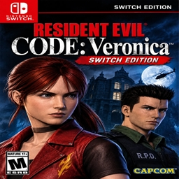
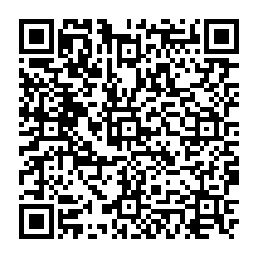

<div align="center">



# Resident Evil Code: Veronica X — NX Port

**Port nativo de *Resident Evil Code: Veronica X* (PS2) para Nintendo Switch**


[](https://ko-fi.com/gerissoncassiano)

🇧🇷 [Português](README.md) · 🇺🇸 [English](README.en.md) · 🇪🇸 **Español**

[**Descargar**](../../releases/latest) · [Instalación](#-instalación) · [Controles](#-controles) · [Compilar](#%EF%B8%8F-compilar) · [Créditos](#-créditos) · [**Apoyar**](#-apoya-el-proyecto)

</div>

> [!IMPORTANT]
> **Este repositorio no contiene el juego.** Necesitas tu propia copia original de
> *Resident Evil Code: Veronica X* (PS2, NTSC-U, **SLUS-20184**), volcada por ti a un archivo `.iso`.

---

## 📖 Acerca de

El código original del juego, de la decompilación [recvx-decomp](https://github.com/AshfordFamily/recvx-decomp),
se **compila de forma nativa para el procesador ARM64 de la Switch**. **No es un emulador:** solo se reproduce el
hardware de la PS2 en los bordes del juego (GS, VU, DMA, sonido, disco, memory card y mando), y las partes
pesadas se sustituyen por caminos nativos. El juego lee tu ISO directamente de la tarjeta SD.

El port se basa en [Project Veronica](https://github.com/camybiohazard/Project-Veronica), el port nativo para PC.

## ✨ Características

| | |
|---|---|
| 🎮 **Nativo** | Código del juego compilado para ARM64, renderizado en la GPU con OpenGL 3.3 |
| 🖥️ **Imagen mejorada** | Pantalla panorámica, mayor resolución interna, fotogramas intermedios para un movimiento fluido (la lógica del juego sigue a sus 30 FPS originales) |
| 🎯 **Puntería con giroscopio** | Funciona en modo portátil, con el Pro Controller y con los Joy-Con, con velocidad e inversión ajustables |
| 🧍 **Tercera persona** | Cámara opcional sobre el hombro, con puntería libre y puntería automática |
| ⚡ **Menú rápido** | **L3 + R3** abre un menú estilo consola con las opciones principales, sin salir del juego |
| 🧪 **Trucos** | Vida y munición infinitas, curar, dar cualquier objeto, atravesar paredes, desbloquear todo |
| 💾 **Partidas modernas** | Cada partida es un archivo propio en la tarjeta SD, sin límite |
| 🧩 **Mods** | Salas y archivos de reemplazo, y paquetes de texturas HD de PCSX2 tal como vienen |

## 📦 Requisitos

- Una Nintendo Switch con homebrew (Atmosphère + Homebrew Menu)
- Tu ISO de *Resident Evil Code: Veronica X* — PS2, NTSC-U, **SLUS-20184**
- Unos 4 GB libres en la tarjeta SD

> [!TIP]
> Abre el Homebrew Menu **manteniendo R mientras inicias un juego** (title takeover), no desde el Álbum. En modo
> applet hay mucha menos memoria y el juego puede no arrancar.

## 🚀 Instalación

1. Descarga `recvx.nro` de la página de [Releases](../../releases/latest).
2. Cópialo a la tarjeta SD en `sdmc:/switch/recvx/`.
3. Pon **tu** ISO en la misma carpeta (cualquier nombre terminado en `.iso`).
4. Inicia **Code: Veronica X** desde el Homebrew Menu.

```
sdmc:/switch/recvx/
├── recvx.nro      el juego
├── *.iso          tu ISO
├── recvx.ini      opciones (se crea en el primer inicio)
├── recvx.log      registro, para reportar problemas
├── save/          partidas guardadas
└── mods/          opcional: mods y texturas HD (mods/textures/)
```

## 🎮 Controles

El juego usa sus controles originales. El port añade tres menús:

| Botones | Abre |
|---|---|
| **L3 + R3** | **Menú rápido**, con las pestañas **Settings** y **Cheats** |
| **−** y **+** juntos | Todas las opciones, página por página |
| **−** y **+** juntos, manteniendo **ZR** | El menú completo de trucos y herramientas |

**Dentro del menú rápido**

| Botón | Acción |
|---|---|
| Cruceta / stick izquierdo | Elegir (arriba / abajo) y cambiar el valor (izquierda / derecha) |
| **A** | Cambiar o confirmar |
| **L** / **R** | Cambiar entre **Settings** y **Cheats** |
| **B** | Cerrar |

El juego sigue en marcha con el menú abierto, pero los controles no llegan al juego hasta que lo cierras.

## ⚡ Menú rápido

**Pestaña Settings**

| Sección | Opciones |
|---|---|
| Cámara y puntería | Tercera persona, giroscopio, velocidad del giroscopio, invertir X / Y, sensibilidad de cámara y puntería, puntería automática, punto de mira |
| Imagen | Escala, fotogramas intermedios, relación de aspecto, brillo, mostrar FPS |
| Sonido | Volumen de la música y de los efectos |
| Juego | Saltar las puertas, carga rápida |

**Pestaña Cheats**

| Opción | Efecto |
|---|---|
| Infinite health | La vida siempre está llena |
| Heal now | Llena la vida una vez |
| Infinite ammo | El arma equipada nunca se queda sin munición |
| Item / Count / Add to inventory | Elige cualquier objeto y la cantidad, y ponlo en el inventario |

Los cambios se guardan solos.

## 🎯 Puntería con giroscopio

Con la tercera persona activada, el sensor de movimiento del mando apunta como un ratón:

- **Gyro aiming:** *Off*, *While aiming* (por defecto) o *Aim and camera*
- **Gyro speed:** del 10 % al 400 %
- **Gyro invert X / Y**

Funciona en modo portátil, con el Pro Controller y con un par de Joy-Con (apunta el Joy-Con derecho).

## 🛠️ Compilar

```sh
git clone --recursive https://github.com/gerisson1996/RESIDENT-CODE-VERONICA-NX-PORT.git
cd RESIDENT-CODE-VERONICA-NX-PORT
bash scripts/build-switch.sh -- recvx_nro
```

Necesita devkitPro (devkitA64, libnx, switch-sdl2, switch-mesa). Detalles, dónde está el código de la Switch y
las opciones de depuración (en portugués): [docs/BUILDING.md](docs/BUILDING.md).

## 📚 Documentación

| Documento | Contenido |
|---|---|
| [CHANGELOG.md](CHANGELOG.md) | Qué cambió en cada versión del port |
| [docs/BUILDING.md](docs/BUILDING.md) | Compilar para la Switch y depurar |
| [docs/USER_GUIDE.md](docs/USER_GUIDE.md) | Todas las opciones, trucos, partidas y texturas HD (en inglés) |
| [docs/THIRDPERSON.md](docs/THIRDPERSON.md) | Modo tercera persona (en inglés) |
| [docs/modding/](docs/modding/README.md) | Formato de las salas y cómo crear salas nuevas (en inglés) |
| [docs/ARCHITECTURE.md](docs/ARCHITECTURE.md) | Cómo funciona el port por dentro (en inglés) |

## ☕ Apoya el proyecto

El port es gratis y de código abierto. Las herramientas que uso para hacer estos ports son **de pago**, y cada
donación ayuda a mantenerlas y a seguir con el proyecto. ¿Quieres otro juego portado o una mejora? **Haz tu pedido
junto con tu donación** (escríbelo en el mensaje de Ko-fi, PayPal o Pix).

[](https://ko-fi.com/gerissoncassiano)
[](https://www.paypal.com/donate/?hosted_button_id=B3YTKT29F5ZLG)

O por **PIX** (Brasil, clave e-mail): `pocketneogames@gmail.com`



PIX copiar y pegar:

```text
00020126460014br.gov.bcb.pix0124pocketneogames@gmail.com5204000053039865802BR5911RECOMP GUTO6006BRASIL62070503***63048D6B
```

## 🙏 Créditos

- **[Project Veronica](https://github.com/camybiohazard/Project-Veronica)** — camybiohazard: el port nativo para
  PC en el que se basa este port
- **[recvx-decomp](https://github.com/AshfordFamily/recvx-decomp)** — AshfordFamily y colaboradores: la
  decompilación (MIT)
- **[devkitPro](https://devkitpro.org/)** — devkitA64, libnx y los ports de SDL2 / Mesa para la Switch
- Bibliotecas: [SDL](https://github.com/libsdl-org/SDL), [Dear ImGui](https://github.com/ocornut/imgui),
  [miniupnpc / libnatpmp](https://github.com/miniupnp), [Monocypher](https://github.com/LoupVaillant/Monocypher)
  — detalles en [THIRD_PARTY_NOTICES.md](THIRD_PARTY_NOTICES.md)

## ⚖️ Aviso legal

Proyecto de fans, no oficial, sin relación con Capcom, Nintendo, Sony Interactive Entertainment, Sega ni CRI
Middleware, y sin su respaldo. *Resident Evil* y *Code: Veronica* son marcas de Capcom, Nintendo Switch es marca
de Nintendo y PlayStation es marca de Sony Interactive Entertainment. **No se distribuye ningún archivo del
juego:** usa tu propia copia original. No compartas ISOs ni archivos generados a partir de ellas.

El código de este repositorio está bajo la [licencia MIT](LICENSE). La decompilación en `decomp/` es MIT, de sus
autores, y los componentes de terceros mantienen sus propias licencias.
