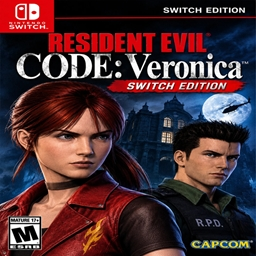

<div align="center">



# Project Veronica NX

**A native Nintendo Switch port of *Resident Evil Code: Veronica X***


[Features](#features) · [Installation](#installation) · [Controls](#controls) · [Building](#building-from-source) · [Credits](#credits)

</div>

> [!IMPORTANT]
> **No game data is included.** You need your own legally obtained copy of *Resident Evil Code: Veronica X*
> (PS2, NTSC-U, **SLUS-20184**), dumped by you to an `.iso` disc image.

---

## About

Project Veronica NX brings [Project Veronica](https://github.com/camybiohazard/Project-Veronica), the native
PC port built on the [recvx-decomp](https://github.com/AshfordFamily/recvx-decomp) decompilation, to the
Nintendo Switch as a homebrew application.

The original game code is compiled natively for the Switch's ARM64 CPU. It is not an emulator. Only the PS2
hardware at the game's boundaries (GS, VU, DMA, sound driver, disc, memory card and pad) is reproduced, and
native paths replace the expensive parts. The game reads your disc image straight from the SD card.

## Features

| | |
|---|---|
| 🎮 **Native performance** | Game code compiled for ARM64; GPU rendering through OpenGL 3.3 (Mesa / nouveau) |
| 🖥️ **Enhanced picture** | Widescreen, higher internal resolution, in-between frames for smooth motion while the game logic stays at its original 30 FPS |
| 🎯 **Gyro aiming** | Motion aiming with the Joy-Con, Pro Controller or handheld mode, adjustable speed and inversion |
| 🧍 **Third-person mode** | Optional over-the-shoulder camera with free aim and auto-aim |
| ⚡ **Quick menu** | L3 + R3 opens a console-style menu for the settings that matter most, without leaving the game |
| 🧪 **Cheats** | Infinite health and ammo, heal, give any item, noclip, unlock all |
| 💾 **Modern saves** | Every save is its own file, as many as you like, on the SD card |
| 🧩 **Mods and HD textures** | Replacement rooms and archive entries; PCSX2 HD texture packs load as they come |
| 🔁 **Model swaps and enemy options** | Play as other characters, extra enemies, a seeded randomizer |

## Requirements

- A Nintendo Switch able to run homebrew (Atmosphère with the Homebrew Menu).
- Your own disc image of *Resident Evil Code: Veronica X*, PS2 NTSC-U, **SLUS-20184** (`.iso`).
- About 4 GB of free space on the SD card for the disc image.

> [!TIP]
> Launch the Homebrew Menu by **holding R while opening a game** (title takeover), not from the album
> applet. Applet mode has much less memory and the game may not start.

## Installation

1. Download `recvx.nro` from the [Releases](../../releases) page.
2. Copy it to the SD card:
   ```
   sdmc:/switch/recvx/recvx.nro
   ```
3. Copy **your** disc image into the same folder (any name ending in `.iso`):
   ```
   sdmc:/switch/recvx/Code Veronica X.iso
   ```
4. Start **Code: Veronica X** from the Homebrew Menu.

Everything the game writes lives next to it:

```
sdmc:/switch/recvx/
├── recvx.nro          the game
├── *.iso              your disc image
├── recvx.ini          settings (written on the first start)
├── recvx.log          log, for bug reports
├── save/              save files
└── mods/              optional: mods and HD texture packs (mods/textures/)
```

## Controls

The game plays with its original controls. On top of them, the port adds three menus:

| Buttons | Opens |
|---|---|
| **L3 + R3** | **Quick menu**: camera and aim, gyro, picture, sound, game options, and a **Cheats** tab |
| **−** and **+** together | All settings, page by page |
| **−** and **+** together, holding **ZR** | The full cheats and debug menu |

Inside the quick menu:

| Button | Action |
|---|---|
| D-pad / left stick | Choose an option (up / down), change it (left / right) |
| **A** | Change or confirm |
| **L** / **R** | Switch between the **Settings** and **Cheats** tabs |
| **B** | Close |

The game keeps running while a menu is open; game input is paused until you close it.

## Gyro aiming

With third-person mode on, the controller's motion sensor aims like a mouse:

- **Gyro aiming**: *Off*, *While aiming* (default) or *Aim and camera*.
- **Gyro speed**: 10 % to 400 %.
- **Gyro invert X / Y**.

All of them are in the quick menu (L3 + R3) under **Camera and aim**. The gyro works in handheld mode,
with a Pro Controller, and with a pair of Joy-Con (the right one aims).

## Building from source

The Switch build uses [devkitPro](https://devkitpro.org/) (devkitA64, libnx, switch-sdl2, switch-mesa).

```sh
git clone --recursive https://github.com/gerisson1996/RESIDENT-CODE-VERONICA---NX---PORT.git
cd RESIDENT-CODE-VERONICA---NX---PORT
# from devkitPro's msys2 shell (Windows) or a shell with $DEVKITPRO set (Linux / macOS)
bash scripts/build-switch.sh -- recvx_nro
```

The output is `build-switch/pc/recvx.nro`. The PC builds (Linux and Windows) from the upstream project still
work from this tree: see [docs/BUILDING.md](docs/BUILDING.md).

### Debugging

`sdmc:/switch/recvx/env.txt` sets environment variables at start, one `NAME=value` per line. For example,
`RECVX_GPU_TIME=1` writes per-frame CPU and GPU timings to `recvx.log`.

## Documentation

| Document | For |
|---|---|
| [docs/USER_GUIDE.md](docs/USER_GUIDE.md) | Every setting, controls, cheats, saves, troubleshooting |
| [docs/THIRDPERSON.md](docs/THIRDPERSON.md) | Third-person mode |
| [docs/HD_PACK.md](docs/HD_PACK.md) | HD texture packs |
| [docs/modding/](docs/modding/README.md) | Room format and building custom rooms |
| [docs/ARCHITECTURE.md](docs/ARCHITECTURE.md) | How the port works |
| [docs/BUILDING.md](docs/BUILDING.md) | Building for every platform |
| [CHANGELOG.md](CHANGELOG.md) | Feature history |

## Credits

- **[Project Veronica](https://github.com/camybiohazard/Project-Veronica)** by camybiohazard: the native PC
  port this Switch version is based on.
- **[recvx-decomp](https://github.com/AshfordFamily/recvx-decomp)** by AshfordFamily and its contributors:
  the decompilation everything is built on (MIT).
- **[devkitPro](https://devkitpro.org/)**: the Switch toolchain, libnx and the SDL2 / Mesa ports.
- Libraries: [SDL](https://github.com/libsdl-org/SDL) (zlib), [Dear ImGui](https://github.com/ocornut/imgui)
  (MIT), [miniupnpc and libnatpmp](https://github.com/miniupnp) (BSD-3-Clause),
  [Monocypher](https://github.com/LoupVaillant/Monocypher) (BSD-2-Clause or CC0). Details:
  [THIRD_PARTY_NOTICES.md](THIRD_PARTY_NOTICES.md).

## License

The code in this repository is released under the [MIT License](LICENSE). The decompilation in `decomp/` is
MIT-licensed by its authors; third-party components keep their own licenses.

## Legal

This is an unofficial fan project, not affiliated with or endorsed by Capcom, Nintendo, Sony Interactive
Entertainment, Sega or CRI Middleware. *Resident Evil* and *Code: Veronica* are trademarks of Capcom; Nintendo
Switch is a trademark of Nintendo; PlayStation is a trademark of Sony Interactive Entertainment. No game assets
are distributed: you must supply your own legally obtained copy of the game. Do not share disc images or files
generated from them.
